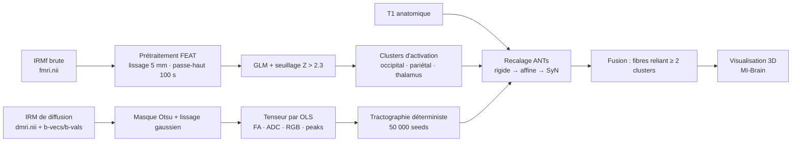

<div align="center">

# 🧠 Imagerie cérébrale multimodale
### Fusion IRM fonctionnelle × IRM de diffusion × T1 : du recalage à la tractographie

*Pipeline complet de reconstruction et d'analyse d'images médicales : visualisation, débruitage, recalage, GLM, tenseur de diffusion codé from scratch, tractographie déterministe et fusion fonctionnelle/structurelle.*


**Projet académique · IMN 708 – Reconstruction et analyse d'images médicales · Université de Sherbrooke (Automne 2025)**

</div>

---

## 📌 Résumé

Ce dépôt regroupe trois travaux pratiques qui forment un projet de bout en bout autour d'une question de neuro-imagerie :

> **Quelles régions du cerveau s'activent pendant une tâche visuo-spatiale, et par quelles fibres de matière blanche sont-elles reliées ?**

À partir de données brutes d'**IRM fonctionnelle** (tâche « Roland »), d'**IRM de diffusion** et d'une **IRM T1** anatomique, le pipeline :

1. détecte les zones d'activation (modèle linéaire général, FSL FEAT) ;
2. reconstruit les tenseurs de diffusion et une **tractographie déterministe codée à la main** (NumPy / DIPY) ;
3. recale le tout dans l'espace T1 du sujet (ANTs, SyN) ;
4. **filtre les fibres** pour ne garder que celles reliant au moins deux clusters d'activation ;
5. met en évidence un faisceau de matière blanche occipito-pariétal, cohérent avec la **voie dorsale (« voie du Où »)**.

---

## 🔬 Pipeline



---

## 🧩 Contenu du projet

### TP1 · Visualisation, statistiques et débruitage
| Livrable | Description |
|---|---|
| `view_image.py` | Visualiseur interactif NIfTI (axial / coronal / sagittal) avec sliders et respect des proportions physiques des voxels |
| `compute_mIP.py` | Projections d'intensité maximale (MIP) et minimale (mIP) selon un axe choisi |
| `check_orientation.py` | Vérification de l'orientation (RAS / LPI…) via la matrice affine |
| `show_image_stats.py` | Lecture d'en-têtes **NIfTI, DICOM, PGM, VFF** : taille des voxels, contraste de Michelson / RMS, histogrammes |
| `denoise_*.py` | Débruitage **médian 3D**, **bilatéral** et **Non-Local Means** (scikit-image) |

**Constats :** les coupes sagittales/coronales du FLAIR sont plus floues que l'axiale (voxels anisotropes : 0,82 × 0,82 × 7,4 mm), alors que le T1 isotrope reste net dans les trois plans. Le NLMeans offre le meilleur compromis bruit / préservation des détails ; le bilatéral sur-lisse ; le médian est un bon choix rapide.

### TP2 · Recalage d'images
- **Histogramme conjoint** et trois critères de similarité implémentés à la main : **SSD, coefficient de corrélation, information mutuelle** (comparés sur 6 paires d'images, dont IRM/CT).
- **Transformations 3D** (rigide, similitude) construites matriciellement + outil d'analyse de matrices (erreur d'orthogonalité, déterminant, valeurs singulières) pour classer une transformation.
- **Recalage iconique 2D** : recherche exhaustive en translation et en rotation, puis **descente de gradient rigide** (p, q, θ) et version **multi-échelle** (σ = 4 → 2 → 1).
- **Prise en main d'ANTs** : translation, rigide, affine et **SyN** (information mutuelle, schéma multi-résolution 8×4×2×1), warping d'atlas (MNI, JHU, thalamus) vers l'espace du sujet.

**Constats :** les translations et rotations artificielles sont retrouvées avec précision (ex. −20°, −70°, −120°). Le modèle rigide atteint ses limites pour les transformations importantes et combinées (minimum local), ce qui motive l'affine puis le non-linéaire. Sur FLAIR → T1, **SyN** donne l'alignement le plus fin.

### TP3 · Fusion IRM de diffusion et fonctionnelle
**① IRM fonctionnelle (FSL FEAT)**
- Lissage spatial gaussien 5 mm, filtre passe-haut temporel 100 s, correction de mouvement déjà appliquée.
- GLM avec régresseur idéal (déjà convolué avec la HRF, donc **convolution désactivée** pour éviter une double convolution).
- Seuillage **Z > 2.3**, extraction du cerveau (BET), recalage de la carte Z sur le T1.
- Activations bilatérales : **cortex visuel (occipital), lobule pariétal supérieur, thalamus**.

**② IRM de diffusion (algorithmes codés from scratch)**
- Masque cérébral (`median_otsu`) + lissage gaussien spatial (σ = 0,75 voxel, sans lisser l'axe des directions).
- **Estimation du tenseur par moindres carrés ordinaires** (log-linéarisation + pseudo-inverse de Moore-Penrose), 6 composantes sauvegardées en NIfTI 5D compatible ANTs.
- Décomposition en valeurs propres → cartes **FA, ADC, RGB (orientation × FA)** et **peaks** (direction principale).
- **Tractographie déterministe** : 50 000 seeds dans la matière blanche (FA > 0,2), pas de 0,5 voxel, arrêt si FA < 0,2 ou courbure > 60°, export `.trk` → **37 975 fibres** générées.

**③ Fusion fonctionnel × structurel**
- Tout est ramené dans l'**espace T1 du sujet** (recalage non-linéaire SyN via ANTs).
- Étiquetage des clusters d'activation (`scipy.ndimage.label`), élimination des petits clusters (< 50 voxels), conservation des plus grands.
- **Filtre de connectivité** : une fibre n'est conservée que si elle touche **au moins deux clusters d'activation distincts**, ce qui réduit un tractogramme complet au réseau pertinent pour la tâche.
- Résultat : un faisceau occipito-pariétal cohérent avec la **voie dorsale** (interprété dans le rapport comme relevant du faisceau longitudinal supérieur).

---

## 🖼️ Aperçu

| IRMf : clusters d'activation | Tenseur de diffusion : FA / RGB | Tractographie |
|:---:|:---:|:---:|
|  |  |  |

| Recalage FLAIR → T1 (SyN) | Débruitage (NLMeans) | **Fusion IRMf + fibres sur T1** |
|:---:|:---:|:---:|
|  |  |  |

---

## 🗂️ Structure du dépôt

```
.
├── README.md
├── DATA.md                 # comment obtenir / placer les données
├── requirements.txt
├── tp1_visualisation_debruitage/
│   ├── view_image.py
│   ├── compute_mIP.py
│   ├── check_orientation.py
│   ├── show_image_stats.py
│   └── denoise_median.py · denoise_bilateral.py · denoise_nlmeans.py
├── tp2_recalage/
│   ├── show_joint_hist.py
│   ├── compare_pairs.py
│   ├── transform_grid.py
│   ├── register_image.py
│   └── ants_demo.sh
├── tp3_fusion/
│   ├── dmri_processing.py   # tenseur OLS, FA/ADC/RGB, tractographie
│   └── fusion_tracking.py   # filtrage des fibres par clusters d'activation
├── reports/                 # rapports PDF des 3 TP
├── docs/figures/            # captures utilisées dans ce README
└── data/                    # (non versionné) voir DATA.md
```

---

## ⚙️ Installation et utilisation

```bash
git clone https://github.com/<ton-user>/<ton-repo>.git
cd <ton-repo>
python -m venv .venv && source .venv/bin/activate
pip install -r requirements.txt
```

Outils externes utilisés : **FSL (FEAT, BET)**, **ANTs**, **MI-Brain** et **Fiji/ImageJ** pour la visualisation.

```bash
# TP1 : visualiseur interactif
python tp1_visualisation_debruitage/view_image.py data/flair.nii

# TP1 : MIP selon l'axe axial
python tp1_visualisation_debruitage/compute_mIP.py data/flair.nii --axis 2 --mode max

# TP2 : comparaison de critères de similarité
python tp2_recalage/compare_pairs.py I1.png J1.png

# TP3 : DTI + tractographie
python tp3_fusion/dmri_processing.py

# TP3 : fusion (tractographie filtrée par les clusters d'activation)
python tp3_fusion/fusion_tracking.py
```

> Les données ne sont pas incluses (volume + usage pédagogique). Voir [`DATA.md`](DATA.md).

---

## ⚠️ Limites et pistes d'amélioration

- **Tenseur de diffusion** : le modèle DTI gère mal les croisements de fibres ; des modèles de type ODF / CSD et un tracking probabiliste amélioreraient la couverture.
- **Tractographie** : pas de validation contre une vérité terrain ; l'interprétation anatomique repose sur l'inspection visuelle.
- **Recalage 2D maison** : modèle rigide uniquement, sensible aux minima locaux pour les grandes transformations ; une métrique d'information mutuelle et un modèle affine/déformable seraient la suite logique.
- **NLMeans** appliqué en 2D coupe par coupe pour des raisons de temps de calcul.
- **Pistes** : parcellisation par atlas (JHU), statistiques de groupe, évaluation quantitative (Dice, distance de Hausdorff) si des segmentations de référence sont disponibles.

---

## 👩‍💻 Auteures

- **Eve Bensoussan** – [LinkedIn](https://www.linkedin.com/in/eve-bensoussan/) · [GitHub](https://github.com/evebensoussan)
- **Léhna Bouchama** – [LinkedIn](https://linkedin.com/in/léhna-bouchama-786547214)· [GitHub](https://github.com/LehnaBOUCHAMA)

Projet réalisé dans le cadre du cours **IMN 530 / IMN 708 – Reconstruction et analyse d'images médicales**, Département d'informatique, Université de Sherbrooke.

## 📄 Licence

Code distribué sous licence MIT (voir `LICENSE`). Les données et énoncés appartiennent à leurs propriétaires respectifs.
